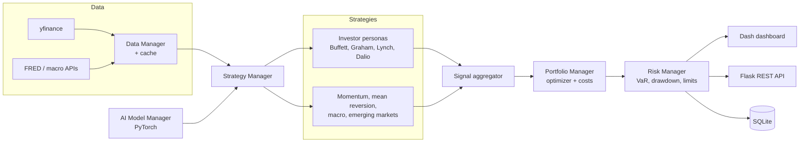

# AI Hedge Fund (v1)

**A modular, multi-agent equity research framework in Python.** Investor-persona agents, quantitative strategy modules, portfolio optimization and risk analytics run together, with an LLM (Google Gemini) layer on top that writes the final recommendation.

> **Project status:** early exploratory project (May to June 2025). It is kept here as part of a portfolio and is not maintained. It was followed by [AI-HedgeFund-2](https://github.com/njliautaud/AI-HedgeFund-2), then by the QuantTime order-book work. The author's current quant research is in **[Lvl3Quant](https://github.com/njliautaud/Lvl3Quant)**.

---

## What it does

The repository has two layers:

1. **Analyst pipeline (small, self-contained).** `example.py` and `llm_manager.py` run four rule-based analyst agents on a ticker: fundamental, technical, sentiment and market context. Each agent returns a 0 to 100 score and a written summary. An `LLMInvestmentManager` then sends those outputs to Gemini with an explicit rule set, for example "buy when fundamental > 70 and technical > 60 and sentiment is positive". Gemini returns a buy, hold or sell decision with its reasoning.
2. **Framework (larger, prototype).** `main.py` is an async orchestrator. It connects a data manager, a strategy manager, a portfolio manager, a risk manager and an AI model manager. A Plotly Dash dashboard and a Flask REST API sit on top.

## Highlights

- **Investor-persona agents** (`src/agents/`, `src/strategies/`). Rule sets modeled on Warren Buffett, Benjamin Graham, Peter Lynch and Ray Dalio. Each has its own analysis dataclass: intrinsic value and margin of safety, the Graham number, PEG-style growth, and economic-regime classification.
- **Quantitative strategies.** Momentum, mean-reversion, emerging-markets and economic/macro strategies. Their signals are combined by a weighted `SignalAggregator`, and the weights for each strategy are set in `config.yaml`.
- **Portfolio optimization** (`src/utils/portfolio_optimizer.py`). Mean-variance, minimum-variance, maximum-Sharpe, risk-parity and Black-Litterman optimizers built on SciPy, plus efficient-frontier generation.
- **Risk analytics** (`src/utils/risk_metrics.py`):
  - historical and Monte Carlo VaR/CVaR
  - Sharpe, Sortino and Calmar ratios
  - beta, alpha, tracking error and information ratio
  - stress tests and rolling risk
- **Transaction cost model.** Commission, bid-ask spread, market impact, slippage and timing cost.
- **Macro toolkit.** FRED economic indicators, yield-curve analysis, sector rotation and correlation analysis.
- **AI model manager.** A PyTorch training and inference service with hardware detection and TensorBoard logging.
- **Interfaces.** A Dash dashboard (portfolio, strategy signals, risk and emerging-markets views), a Flask REST API, and SQLite persistence.

## Architecture



The simpler analyst pipeline is `agents/*` → `LLMInvestmentManager` → Gemini → recommendation.

## Tech stack

Python 3.9+ · pandas / NumPy / SciPy · yfinance · Google Generative AI (Gemini) · PyTorch · Plotly Dash + Dash Bootstrap Components · Flask · SQLite · loguru · pytest

## Repository structure

| Path | Contents |
|---|---|
| `example.py`, `llm_manager.py` | Analyst pipeline: four scoring agents plus a Gemini decision layer |
| `agents/` | Fundamental, technical, sentiment and market analyst agents |
| `main.py` | Framework orchestrator (`--mode run`, plus `backtest` and `train` stubs) |
| `src/core/` | Data, strategy, portfolio, risk, database and AI-model managers |
| `src/agents/` | Investor-persona agents and the agent manager |
| `src/strategies/` | Persona strategies plus momentum, mean-reversion, macro and emerging-markets strategies |
| `src/utils/` | Optimizer, risk metrics, transaction costs, valuation models, technical indicators, yield curve, caching |
| `backtesting/` | Standalone backtest engine |
| `ui/`, `api/` | Dash dashboard, callbacks and components; Flask API servers |
| `tests/` | Dashboard and API endpoint tests |
| `config.yaml` | System, trading, strategy-weight, risk and UI settings |

## Running it

```bash
python -m venv .venv && source .venv/bin/activate   # Windows: .venv\Scripts\activate
pip install -r requirements.txt
# the framework layer also needs: dash dash-bootstrap-components flask flask-cors scipy torch pyyaml
cp .env.example .env        # then set GEMINI_API_KEY

python check_config.py      # sanity-check environment and config
python example.py           # analyst pipeline on a few large-cap tickers
python run_dashboard.py     # Dash dashboard (port set in config.yaml)
python main.py --mode run   # full framework loop (paper mode)
```

- **Required:** `GEMINI_API_KEY`, for the LLM decision layer.
- **Optional:** keys for other data providers go in the `api_keys` section of `config.yaml`. Use your own keys.

**Known gaps (as left in 2025):**

- `--mode backtest` and `--mode train` point to modules that were never finished. The standalone engine is in `backtesting/`.
- There is no broker integration, so everything runs as analysis or paper simulation.

## Disclaimer

This is an educational research project, not investment advice. Nothing here was used to manage real capital.
